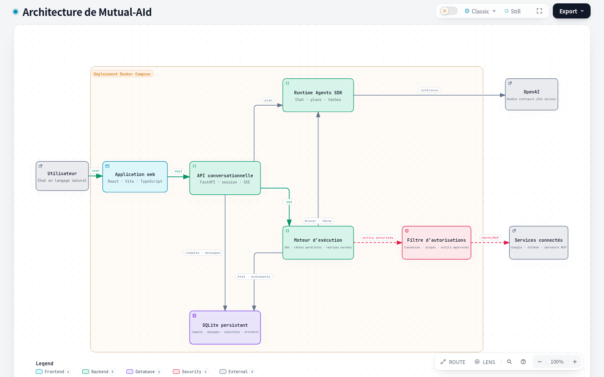

# Mutual-AId

Mutual-AId est une application de chat qui peut transformer une demande complexe en tâches confiées à des agents spécialisés. Elle comprend un frontend React, une API FastAPI, un planificateur OpenAI, un suivi d’exécution et des connecteurs externes soumis aux autorisations de l’utilisateur.

> L’application utilise un espace de travail local partagé : il n’y a pas de comptes ni de connexion. Ne l’exposez pas sur Internet.

## Architecture

<p align="center">
  <a href="./.archify/architecture-mutual-aid-20261027-114110/mutual-aid.html">
    
  </a>
  <br>
  <a href="./.archify/architecture-mutual-aid-20261027-114110/mutual-aid.html"><strong>Explorer la carte d’architecture interactive →</strong></a>
</p>

## Démarrage avec Docker

Prérequis : Docker avec Docker Compose v2.24 ou plus récent. Depuis la racine du dépôt :

```bash
cp backend/.env.example backend/.env
```

Renseignez `OPENAI_API_KEY` et `OPENAI_MODEL` dans `backend/.env`, puis démarrez l’application :

```bash
docker compose up --build
```

- Application : <http://127.0.0.1:5173>
- API et documentation : <http://127.0.0.1:8000/docs>

Le premier démarrage construit les images et nécessite une connexion Internet. Les données sont conservées dans le volume Docker `mutual-aid-data`. `Ctrl+C` arrête les services ; `docker compose down` les arrête sans supprimer les données. Pour réinitialiser l’espace local :

```bash
docker compose down -v
```

## Démarrage pour le développement

Prérequis : Node.js 22.12+, Python 3.12+, [`uv`](https://docs.astral.sh/uv/) et `curl`. La commande suivante prépare les dépendances et les fichiers d’environnement d’exemple, puis démarre Vite et FastAPI :

```bash
npm run dev:all
```

Ouvrez <http://127.0.0.1:5173>. `Ctrl+C` arrête les deux serveurs. Les données du mode natif sont stockées sous `backend/data/`, séparément du volume Docker.

Pour lancer les services séparément, installez les dépendances puis démarrez le backend dans un terminal :

```bash
cd backend
uv sync --group dev --locked
uv run uvicorn app.main:app --reload --host 127.0.0.1 --port 8000
```

Dans un second terminal, à la racine du dépôt :

```bash
npm ci
npm run dev -- --host 127.0.0.1
```

## Configuration

Les secrets sont lus par le backend depuis `backend/.env`.

| Variable | Utilité |
| --- | --- |
| `OPENAI_API_KEY` | Clé API utilisée par le planificateur, les agents et la revue des résultats. |
| `OPENAI_MODEL` | Modèle compatible avec le SDK OpenAI Agents. |
| `OPENAI_REASONING_EFFORT` | Niveau de raisonnement ; `low` est la valeur par défaut. |
| `GOOGLE_OAUTH_CLIENT_ID`, `GOOGLE_OAUTH_CLIENT_SECRET`, `GOOGLE_OAUTH_REDIRECT_URI` | OAuth Google pour Gmail, Drive et Calendar. |
| `GITHUB_APP_CLIENT_ID`, `GITHUB_APP_CLIENT_SECRET`, `GITHUB_APP_REDIRECT_URI` | OAuth GitHub en lecture seule. |
| `CONNECTOR_TOKEN_ENCRYPTION_KEY` | Clé Fernet stable pour chiffrer les jetons de connecteurs stockés localement. |

Gmail, Drive et Calendar demandent les API correspondantes dans Google Cloud. Le callback local Google est `http://127.0.0.1:8000/api/connectors/google_calendar/callback`. Pour GitHub, configurez une OAuth App avec le callback `http://127.0.0.1:8000/api/connectors/github/callback` et des permissions de lecture. Après configuration, redémarrez l’application et connectez le service depuis **Connecteurs**.

Pour générer la clé de chiffrement, depuis `backend/` :

```bash
uv run python -c "from cryptography.fernet import Fernet; print(Fernet.generate_key().decode())"
```

## Scénarios à essayer

Ces demandes sont conçues pour rendre visibles les choix des agents, les outils consultés et les limites des données. Connectez le service concerné puis activez-le dans le composer avant l’essai. Les connecteurs intégrés sont en lecture seule.

### Santé et agenda

Avec Google Calendar connecté, demandez :

> Consulte mon agenda des sept prochains jours et aide-moi à répartir trois séances de marche de 30 minutes, mes cours et des horaires de sommeil réguliers. Vérifie les conflits, distingue les événements observés de tes hypothèses et explique les compromis. Ne modifie pas mon agenda. Si une information indispensable manque, pose-moi une question avant de proposer un planning.

Ce scénario vérifie l’agent planificateur, le conseiller santé, la lecture de l’agenda et la revue du résultat. Le système doit demander les contraintes manquantes au lieu d’inventer des disponibilités.

### Issues GitHub

Après avoir connecté GitHub, activez-le dans le composer et demandez :

> Dans `Sawlyer/Mutual-AId`, analyse les issues ouvertes. Regroupe-les par thème, indique les blocages et propose trois prochaines actions avec les numéros d’issues. N’effectue aucune modification.

Vérifiez que les recommandations citent des numéros d’issues et que le connecteur ne fait que lire.

### Préparer une synthèse depuis Gmail

Avec Gmail connecté, demandez :

> Recherche les derniers messages de mon enseignante qui mentionnent les soutenances. Résume les échéances, les attentes de présentation et les questions auxquelles notre équipe doit répondre. Signale les éléments qui ne figurent pas dans les extraits disponibles. Ne réponds à aucun message.

Le connecteur expose les résultats de recherche et leurs extraits ; demandez à Mutual-AId de signaler clairement quand ils ne suffisent pas à confirmer un détail.

### Retrouver des documents dans Drive

Avec Google Drive connecté, demandez :

> Recherche dans mon Drive les fichiers dont le nom évoque le MVP ou la soutenance. Classe-les par type et date de modification, puis indique lesquels semblent les plus récents. N’ouvre, ne déplace et ne modifie aucun fichier.

Ce scénario teste la recherche de métadonnées Drive. Il ne demande pas de résumer le contenu des fichiers.

### Outils d’un serveur MCP

Après avoir ajouté un serveur MCP, testé sa connexion et approuvé ses outils de lecture, demandez :

> Consulte les informations accessibles en lecture sur [l’objet que ce serveur MCP expose]. Résume les éléments utiles et indique les outils utilisés. Ne crée, ne modifie et ne supprime rien.

Dans la fiche de l’agent, seules les suggestions pertinentes sont mises en avant ; l’affectation à l’agent reste à confirmer. À l’exécution, les outils doivent être approuvés, affectés à cet agent et autorisés pour la conversation.

### Vérifier les compétences d’un agent

Dans **Agents**, ouvrez un profil et consultez la bibliothèque locale. Les compétences recommandées sont classées d’après le rôle et la description de l’agent. Essayez d’affecter une compétence pertinente, puis lancez une demande liée à son rôle et vérifiez qu’elle apparaît dans l’exécution. Une compétence générée reste inactive tant qu’elle n’a pas été approuvée.

## Fonctionnalités

- Chat avec historique local, réponses en streaming et rendu Markdown.
- Planification des demandes complexes, graphe de tâches, suivi d’exécution et revue du résultat.
- Agents spécialisés réutilisables, avec compétences locales modifiables.
- Connecteurs Google, GitHub et serveurs MCP ; les outils ne sont fournis à l’agent que s’ils sont disponibles et autorisés.
- Tableau d’analyse des exécutions et de l’usage des modèles.

Les connecteurs intégrés sont en lecture seule. L’application ne réalise pas d’écriture externe ni d’exécution automatique non autorisée.

## Vérifications

À la racine du dépôt :

```bash
npm run typecheck
npm run lint
npm run test
npm run build
```

Tests backend, depuis `backend/` :

```bash
PYTEST_DISABLE_PLUGIN_AUTOLOAD=1 uv run pytest
```
