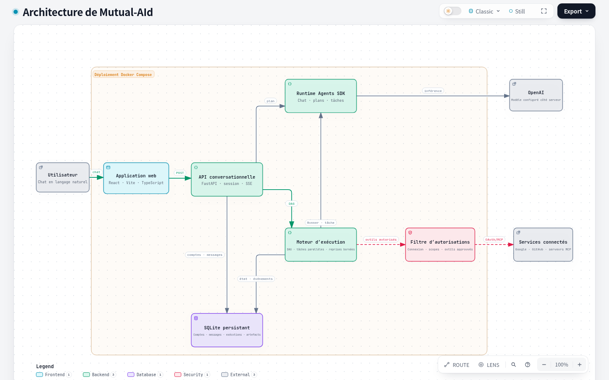

# Mutual-AId

Mutual-AId est une interface de chat React + Vite + TypeScript reliée à un backend FastAPI. Le backend utilise le SDK officiel OpenAI Agents, conserve les conversations dans SQLite et peut planifier les demandes complexes en tâches suivies dans un workflow. Google Calendar est disponible en lecture seule lorsque son OAuth est configuré.

## Architecture

<p align="center">
  <a href="./.archify/architecture-mutual-aid-20261027-114110/mutual-aid.html">
    
  </a>
  <br>
  <a href="./.archify/architecture-mutual-aid-20261027-114110/mutual-aid.html"><strong>Télécharger la carte interactive (HTML autonome) →</strong></a>
</p>

Le schéma source-backed résume le parcours du chat, la séparation entre réponse simple et exécution en DAG, la persistance SQLite et les contrôles d’accès des connecteurs.

Les agents de code s’appuient sur `AGENTS.md` (aussi dans `src/`, `backend/`, `backend/app/connectors/` et `backend/tests/`) et sur `.agents/skills/`. Cursor reprend ce contexte dans `.cursor/rules/` et `.cursor/skills/`. Ce README reste le guide d’installation.

## Démarrage rapide avec Docker

Installez et démarrez Docker Desktop (Windows/macOS) ou Docker Engine avec le plugin Docker Compose (Linux), puis lancez cette même commande depuis la racine du dépôt, dans PowerShell, Terminal ou un terminal Linux/macOS :

```bash
docker compose up --build
```

Docker construit et lance le frontend et le backend. Il n'est pas nécessaire d'installer Node.js, Python, `uv`, npm ou Bash sur la machine hôte. Le premier lancement télécharge les images de base et construit les dépendances ; une connexion Internet est nécessaire.

- Application : <http://127.0.0.1:5173>
- Backend et documentation API : <http://127.0.0.1:8000/docs>

Pour obtenir de vraies réponses IA, créez `backend/.env` à partir de `backend/.env.example` et renseignez `OPENAI_API_KEY` ainsi que `OPENAI_MODEL`. Compose charge automatiquement ce fichier s'il existe. Les clés restent côté backend et ne sont pas intégrées aux images Docker. Sans clé, les conteneurs démarrent mais le backend ne peut pas fournir de réponses OpenAI.

Les comptes, conversations et sessions SQLite sont conservés dans un volume Docker nommé. **Ctrl+C** arrête le lancement au premier plan sans supprimer les données. `docker compose down` arrête et retire les conteneurs, tout en conservant les données. Pour effacer aussi les données locales, utilisez `docker compose down -v`.

Compose v2.24 ou plus récent est nécessaire pour que le fichier local `backend/.env` soit facultatif. Il est inclus dans Docker Desktop à jour ; sur Linux, installez le plugin Docker Compose correspondant à votre distribution.

## Démarrage natif (sans Docker)

Pour le développement natif, la commande Bash existante reste disponible. Elle nécessite Node.js 20.19+ ou 22.12+, Python 3.10+, `uv` et `curl` :

```bash
npm run dev:all
```

Elle installe les dépendances si nécessaire, prépare les fichiers d’environnement d’exemple s’ils n’existent pas, puis démarre Vite et FastAPI. **Ctrl+C arrête proprement les deux serveurs.** Configurez `backend/.env` comme indiqué ci-dessus pour activer les réponses IA. Les données de ce mode natif restent dans `backend/data/`, séparées du volume Docker.

## Configuration manuelle

À la racine du dépôt :

```bash
npm install
cp .env.example .env.local
cd backend && uv sync --group dev && cp .env.example .env
```

Éditez `backend/.env` et renseignez `OPENAI_API_KEY` ainsi que `OPENAI_MODEL`. La clé reste côté backend et n’est jamais chargée par Vite. `ALLOWED_ORIGINS` doit contenir uniquement les origines du frontend autorisées.

## Lancer l’application

Dans un terminal, depuis `backend/` :

```bash
uv run uvicorn app.main:app --reload --host 127.0.0.1 --port 8000
```

Dans un autre terminal, depuis la racine du dépôt :

```bash
npm run dev -- --host 127.0.0.1
```

Ouvrez l’URL Vite affichée, généralement `http://127.0.0.1:5173`. Le backend expose sa documentation OpenAPI à `http://127.0.0.1:8000/docs` et l’état de configuration à `http://127.0.0.1:8000/api/health`.

Le mode utilisé par défaut est `openai`. Pour revenir au mode de démonstration local, changez `VITE_CHAT_ADAPTER=demo` dans `.env.local`, puis redémarrez Vite. En développement, Vite relaie `/api` vers FastAPI pour garder la session de connexion sur la même origine. Si le frontend et l’API sont déployés séparément, définissez `VITE_API_BASE_URL` avec l’URL complète de l’API.

## API de chat

- `GET /api/health` : disponibilité et présence de la configuration OpenAI, sans exposer la clé
- `POST /api/auth/register`, `POST /api/auth/login`, `POST /api/auth/logout` et `GET /api/auth/me` : comptes et session HttpOnly
- `GET /api/conversations` et `POST /api/conversations` : lister et créer des conversations
- `GET /api/conversations/{id}` : consulter une conversation
- `PATCH /api/conversations/{id}` et `DELETE /api/conversations/{id}` : renommer et supprimer
- `GET /api/conversations/{id}/messages` : récupérer son historique
- `POST /api/conversations/{id}/messages/stream` : envoyer `{ "content": "…" }` et recevoir `text/event-stream`

Le flux SSE émet `user`, `delta`, `mcp.suggestion`, `plan.ready`, `execution.created`, `done` et `error`. Seuls les deltas de texte destinés à l’utilisateur sont transmis ; le raisonnement privé et les erreurs détaillées restent côté serveur. Une suggestion MCP ne contient que l’identifiant de fiche, le nom et la catégorie.

Toutes les routes de conversation et de connecteur nécessitent une session. Les routes historiques `/dashboard`, `/missions/*` et `/executions/*` redirigent vers le chat : elles ne créent plus de données de démonstration qui ressemblent à de vraies exécutions.

## Connecteurs

La page Connecteurs affiche Gmail, Google Drive, Google Calendar et GitHub, puis un lien vers le catalogue MCP. Gmail, Drive et Calendar utilisent le client OAuth Google commun ; GitHub utilise une OAuth App. Chaque service reste `setup_required` tant que ses paramètres serveur ne sont pas présents et passe en lecture seule après configuration.

- `GET /api/connectors` renvoie le catalogue, les permissions et les outils réellement accessibles à l’utilisateur courant.
- `GET /api/conversations/{id}/connectors` lit les connecteurs sélectionnés pour la conversation.
- `PUT /api/conversations/{id}/connectors` enregistre une sélection. Le backend rejette un connecteur déconnecté ou indisponible avec `409`.
- Le corps de `POST /api/conversations/{id}/messages/stream` accepte `connector_ids`. Le backend compare cette liste aux préférences enregistrées, puis ne fournit au SDK Agents que les outils autorisés et dotés des scopes accordés. Les outils d’écriture sans permission explicite, et ceux qui attendent une validation humaine, ne sont pas donnés à l’agent.

Le catalogue MCP est une page dédiée, `/connectors/mcp`. Elle ne liste que les fiches dont la page du répertoire publie une adresse distante dans le bloc « Serveur MCP hébergé ». L’instantané local conserve le nom, la description, la catégorie, l’URL de fiche, les badges, cette adresse et l’indication qu’un jeton utilisateur est obligatoire. Les commandes d’installation et les URL citées seulement dans le texte ne sont pas utilisées. La recherche et les suggestions restent sur la machine ; le texte d’un prompt n’est pas envoyé au répertoire.

Pour rafraîchir l’instantané, depuis `backend/` :

```bash
uv run python scripts/import_mcp_catalog.py
```

Si le répertoire répond par un contrôle anti-robot, enregistrez les fiches déjà analysées dans un fichier JSON et lancez `uv run python scripts/import_mcp_catalog.py --from-json fiches.json`. Le résultat est `backend/app/connectors/data/mcp_catalog.sqlite3`.

Le bouton Mettre à jour relit `https://mcpservers.org/fr/all` et ajoute les nouvelles fiches de ce type. Si le répertoire ne répond pas, la liste déjà enregistrée est conservée. L’activation affiche l’adresse publiée : c’est celle que le backend appellera. Le jeton n’est demandé que lorsque la fiche l’exige. Il est chiffré et n’est jamais réaffiché. Le serveur est créé désactivé, puis testé. Seuls les outils de lecture approuvés peuvent être activés. Les outils d’écriture ou non annotés restent visibles, marqués comme nécessitant une approbation, et ne sont pas exécutables. Un serveur peut être désactivé sans être supprimé. La sélection `mcp:{id}` reste obligatoire dans la conversation. Un profil d’agent n’appelle un outil que s’il lui est aussi affecté. Le backend revérifie ces conditions immédiatement avant chaque appel. Les redirections HTTP sont refusées. Les journaux et l’interface ne conservent pas les jetons.

Les transports acceptés sont HTTP et HTTPS publics, en mode normal comme dans Docker. Aucune commande stdio n’est acceptée, et Compose ne lance pas de processus MCP. L’exemple `backend/examples/readonly_mcp/server.py` est réservé au développement : il n’écoute que sur `127.0.0.1:8765`, expose uniquement l’outil `health`, et n’est joignable que si `MCP_ALLOW_LOOPBACK=true`. Cette variable reste fausse par défaut et n’est pas définie dans Compose. Les adresses privées, le lien local et les métadonnées cloud restent refusées.

L’API fournit `GET /api/connectors/mcp/catalog`, `POST /api/connectors/mcp/catalog/refresh`, `POST /api/connectors/mcp/suggestions`, `GET/POST /api/connectors/mcp`, `POST /api/connectors/mcp/{id}/refresh`, `PATCH /api/connectors/mcp/{id}`, `PUT /api/connectors/mcp/{id}/tools`, `DELETE /api/connectors/mcp/{id}` et `GET/PUT /api/agents/{id}/mcp-tools`. Un jeton exigé par la fiche est chiffré avec `CONNECTOR_TOKEN_ENCRYPTION_KEY` et n’est jamais retourné au frontend.

Le backend stocke les états OAuth à usage unique et les jetons Google chiffrés avec `CONNECTOR_TOKEN_ENCRYPTION_KEY`, séparément par compte. L’outil Calendar revérifie connexion, sélection de conversation et scope à chaque appel, puis ne renvoie que titre, début, fin et statut d’événement. Aucun outil d’écriture Calendar n’est activé. Les comptes disposent d’une inscription, connexion, déconnexion et session persistante en cookie HttpOnly. Les mots de passe sont hachés avec Argon2. Configurez `AUTH_COOKIE_SECURE=true` lorsque l’application est servie en HTTPS.

Pour activer Google, créez un client OAuth de type application Web dans Google Cloud, activez Gmail API, Google Drive API et/ou Google Calendar API selon les services voulus, puis ajoutez exactement `http://127.0.0.1:8000/api/connectors/google_calendar/callback` comme URI de redirection autorisée en local. Copiez `backend/.env.example` vers `backend/.env`, puis définissez `GOOGLE_OAUTH_CLIENT_ID`, `GOOGLE_OAUTH_CLIENT_SECRET`, `GOOGLE_OAUTH_REDIRECT_URI` et une clé Fernet stable dans `CONNECTOR_TOKEN_ENCRYPTION_KEY`. Les autorisations sont limitées à la lecture : Gmail readonly, Drive metadata readonly et Calendar readonly. Générez la clé depuis `backend/` avec `uv run python -c "from cryptography.fernet import Fernet; print(Fernet.generate_key().decode())"`.

Pour GitHub, créez une OAuth App dans les paramètres développeur, inscrivez `http://127.0.0.1:8000/api/connectors/github/callback` comme callback, puis définissez `GITHUB_APP_CLIENT_ID`, `GITHUB_APP_CLIENT_SECRET` et `GITHUB_APP_REDIRECT_URI` dans `backend/.env`. GitHub ne demande que les permissions de lecture nécessaires aux dépôts et issues. Conservez tous les secrets uniquement dans `backend/.env` et redémarrez le backend après configuration. La page Connecteurs affichera les services correctement configurés et permettra de lancer/retirer leur connexion.

## Vérifications

Frontend, à la racine :

```bash
npm run typecheck
npm run lint
npm run build
```

Tests backend, depuis `backend/` :

```bash
PYTEST_DISABLE_PLUGIN_AUTOLOAD=1 uv run pytest
```

## Données et sécurité

Les conversations produit sont dans `backend/data/mutual_aid.sqlite3`. Le SDK Agents conserve également son historique de session dans la base configurée. Les limites par défaut sont de 12 000 caractères par message, 12 requêtes d’écriture par minute et 5 tours d’agent. Ces limites en mémoire sont adaptées au développement local ; une configuration multi-processus nécessite un limiteur partagé et une authentification avant exposition publique.

Les clés sont ignorées par Git via `.env`; seuls les fichiers `.env.example` sans secret sont suivis. N’exposez pas le serveur de développement sur Internet.
